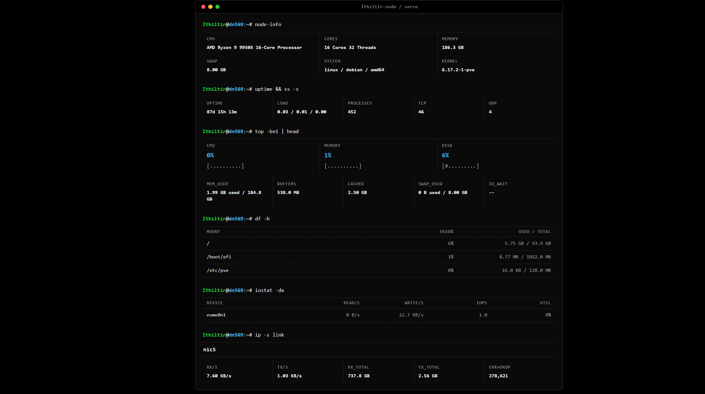

# Ithiltir-node

[中文](README_CN.md)

Node metrics agent with two modes:

- `local`: expose the local page and local APIs
- `push`: post reports to a dashboard and keep a local cached report

## Modes

### Local



```bash
./node
./node local [listen_ip] [listen_port] [--net iface1,iface2] [--debug]
```

- Default listen: `0.0.0.0:9100`
- Env override: `NODE_HOST`, `NODE_PORT`
- Page: `GET /` or `GET /local`
- Metrics endpoint: `GET /metrics`
- Static hardware endpoint: `GET /static`
- Page override: set `ITHILTIR_NODE_LOCAL_PAGE_DIR`, or place `localpage/` next to the binary; public assets live under `localpage/assets/`

### Push

```bash
./node push [interval_seconds] [--net iface1,iface2] [--debug] [--require-https]
```

- Report targets are read from `/var/lib/ithiltir-node/report.yaml` on Linux/macOS and `%ProgramData%\Ithiltir-node\report.yaml` on Windows
- Override the config path with `ITHILTIR_NODE_REPORT_CONFIG`
- Each target URL is the dashboard metrics endpoint and receives `X-Node-Secret: <key>`
- If a target URL ends with `/metrics`, static metadata is posted to the sibling `/static` URL
- Debug local endpoint: `GET http://127.0.0.1:${NODE_PORT:-9101}/`
- HTTPS targets can fall back to HTTP unless `--require-https` is set
- Live metrics requests (HTTP/gRPC) time out after `max(6 seconds, reporting interval + 3 seconds)`. If any target reaches this deadline, the next round starts immediately after the current round finishes. Otherwise, rounds follow the configured reporting interval, starting immediately if the interval has already elapsed.
- Each round reads the latest snapshot without queuing old reports or overlapping rounds.

Report target commands:

```bash
./node report install <url> <key>
./node report remove <id>
./node report update <id> <key>
./node report list
```

Use `report install` from install scripts. The URL must point at the dashboard `/metrics` endpoint. The command reads the dashboard server identity before writing `report.yaml`; rerunning the same install is a no-op, and a different target with the same `server_install_id` prompts which one to keep.
Use `report update` only to rotate an existing target key; URL changes go through `report install`.
The config file keeps `version` and `targets`; each target has `id`, `url`, `key`, and optional `server_install_id`.
Writes are atomic and keep file mode `0600`.

### Windows Runner

```powershell
.\ithiltir-runner.exe [node args...]
```

- Windows only; no args defaults to `push`
- Supervises `%ProgramData%\Ithiltir-node\bin\ithiltir-node.exe` and uses `%ProgramData%\Ithiltir-node` as the working directory
- Enables staged node updates from dashboard metrics responses on Windows

### Self Update

- Windows updates require the runner (`ITHILTIR_NODE_RUNNER=1`) and replace `%ProgramData%\Ithiltir-node\bin\ithiltir-node.exe`
- Linux and macOS updates work only from the installed release layout under `/var/lib/ithiltir-node/releases`; the node downloads the new binary, switches `/var/lib/ithiltir-node/current`, then execs the updated node with the same args and environment
- Update asset downloads send the current target key as `X-Node-Secret`; keep keys out of URLs and query strings
- Direct binaries outside the installed layout do not apply update manifests; the push loop reports self update as disabled and keeps running

### Version

```bash
./node --version
./node -v
```

## PVE VM monitoring

Node `0.3.0` pairs with Dash `0.4.0` and a matching `pve-cache` helper. Existing HTTP host reporting remains compatible; VM history requires `grpc` or `auto` transport and a proxy that forwards the gRPC service path.

The ordinary node optionally reads a root-owned helper socket; there is no separate virtualization node variant. The PVE deployment command in Dash adds `--pve` to the Linux installer, installs the precompiled `pve-cache` helper and systemd service, and configures `ITHILTIR_NODE_TRANSPORT=grpc` for history queries. Node stays unprivileged. The Dash package must include matching helpers; no local compiler, PVE user or API token is needed.

For manual deployment, install the helper outside the node-writable release tree, prepare root-owned `/run/ithiltir-node` readable by the runtime group, and run `pve-cache --group ithiltir` as a root service. It owns basic metrics, slow IP collection and the local query socket. Set `ITHILTIR_NODE_PVE_SOCKET=/run/ithiltir-node/pve.sock` for `node push` to enable independent VM reporting. Unset means no cache reads or VM delivery tasks. `pve-cache --version` reports the node release version. Node self-update never replaces the root-owned helper.

The helper keeps per-VM observations in memory. Eight workers rotate through due VMs; each VM is sampled at most once per three seconds, with no overlapping query for the same VM. Each observation has a two-second deadline, and a completed VM becomes readable immediately without waiting for other VMs or a whole-round deadline. Only QMP status `running` permits dynamic metrics and IPs; other VMs retain configuration and state, and templates are excluded. CPU uses process-counter deltas normalized to vCPUs and the host CPU count, independently of helper CPU affinity. Memory follows PVE cgroup/balloon semantics; disk and tap-network bytes are cumulative counters. Configuration is refreshed every three seconds. Disk capacity uses a separate PVE query every 60 seconds and expires after two minutes. Node reads the current snapshot from the helper Unix socket on its existing three-second VM delivery cadence. Unavailable metrics remain absent. PVE RRD history remains available through the helper; LXC and VM control are not included.

Guest Agent IPs are returned in optional `ips` arrays, up to 1024 unique IPv4/IPv6 addresses per VM, including private addresses and excluding loopback, link-local, unspecified, multicast and invalid addresses. IP collection uses local QGA sockets independently of basic metrics. Only VMs with QMP status `running` and an enabled guest agent are queried. The scheduler checks due work every three seconds, with eight concurrent queries and a three-second total deadline per VM; each round has a ten-second budget and rounds never overlap. Successful queries are eligible again after 60 seconds; failures back off for 1, 2, then 5 minutes. Healthy refreshes have priority, and retries occupy at most two slots. These intervals are minimum delays; saturation can defer a query. Boot or agent configuration changes reset the VM's cached IPs and cooldown. A process lock keeps one helper running; its IP collection loop waits for each round to finish before starting the next. Root-only state in `/run/ithiltir-node/pve-guest` survives helper restarts but is rebuilt after host reboot. Basic collection reads the cached results without waiting for QGA.

## Build

Linux builds also produce `linux/pve_cache_linux_amd64` and `linux/pve_cache_linux_arm64`. Release assets are named `Ithiltir-pve-cache-linux-amd64` and `Ithiltir-pve-cache-linux-arm64`; they share the node version and checksum file.

Build config lives in [`.goreleaser.yaml`](.goreleaser.yaml).

Version format:

```text
MAJOR.MINOR.PATCH[-PRERELEASE][+BUILD]
```

- Strict SemVer, without a `v` prefix.
- Normal releases are only `x.x.x` or `x.x.x+build`.
- Any version with a pre-release part such as `x.x.x-rc.1` or `x.x.x-rc.1+build` is a GitHub pre-release.
- CI rejects invalid SemVer tags before publishing.

Linux/macOS:

```bash
./scripts/build.sh --version 1.2.3-alpha.1
./scripts/build.sh --use-git-tag
./scripts/build.sh --use-git-tag --release
```

Windows:

```powershell
.\scripts\build.ps1 -Version 1.2.3-alpha.1
.\scripts\build.ps1 -UseGitTag
.\scripts\build.ps1 -UseGitTag -Release
```

- Output directory:

```text
build/
  linux/
    node_linux_amd64
    node_linux_arm64
    pve_cache_linux_amd64
    pve_cache_linux_arm64
  macos/
    node_macos_arm64
  windows/
    node_windows_amd64.exe
    node_windows_arm64.exe
    runner_windows_amd64.exe
    runner_windows_arm64.exe
```

- GitHub Release title is the version tag. Node assets are plain binaries named `Ithiltir-node-<os>-<arch>`; Windows runner assets are named `Ithiltir-runner-windows-<arch>`. Windows keeps `.exe`, and checksums are uploaded separately
- The scripts install GoReleaser `v2.17.1` if it is missing

## Docs

- Reporting API: [English](docs/reporting_apis.md), [中文](docs/reporting_apis_CN.md)
- Local page API: [English](docs/local_page_api.md), [中文](docs/local_page_api_CN.md)
- Disk schema: [English](docs/api_disk.md), [中文](docs/api_disk_CN.md)

## Layout

```text
cmd/node         entry point
cmd/runner       Windows runner entry point
internal/app     mode dispatch and lifecycle
internal/cli     flag parsing
internal/collect samplers and platform collectors
internal/metrics runtime and static JSON types
internal/push    push client
internal/reportcfg report target config
internal/runner  Windows runner supervisor
internal/selfupdate staged update support
internal/server  HTTP handlers
scripts/         build scripts
build/           generated artifacts
```

## License

Ithiltir-node is licensed under the GNU Affero General Public License v3.0 only. See [LICENSE](LICENSE).


## Node gRPC transport

HTTP remains the default for compatibility. Set `ITHILTIR_NODE_TRANSPORT=grpc` (RPC only) or `auto` (negotiate before reports) in the Node service environment, then restart Node. Dash serves gRPC on its existing HTTP/2 listener; proxies must forward `/ithiltir.node.v1.Node/` with gRPC support. These modes never authorize plaintext fallback after authentication or TLS failures. PVE history also requires the root helper service (`pve-cache`). Browser APIs and asset downloads remain HTTP.
