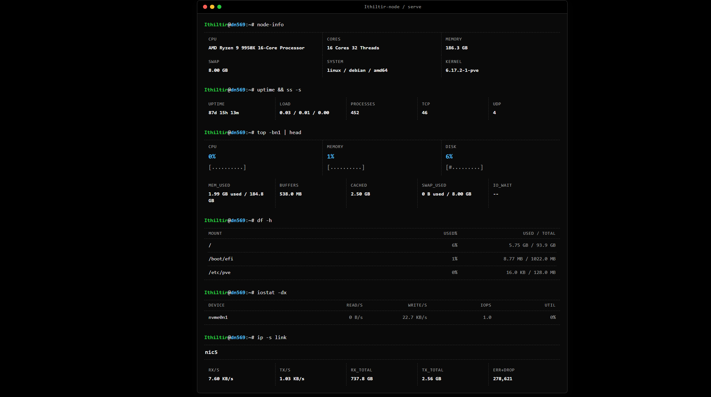

# Ithiltir-node

[English](README.md)

节点指标采集器，只有两种模式：

- `local`：提供本地节点页面和本地接口
- `push`：向面板上报，同时保留本地缓存结果

## 模式

### Local



```bash
./node
./node local [listen_ip] [listen_port] [--net iface1,iface2] [--debug]
```

- 默认监听：`0.0.0.0:9100`
- 环境变量覆盖：`NODE_HOST`、`NODE_PORT`
- 页面：`GET /` 或 `GET /local`
- 指标接口：`GET /metrics`
- 静态硬件接口：`GET /static`
- 页面覆盖：设置 `ITHILTIR_NODE_LOCAL_PAGE_DIR`，或把 `localpage/` 放在二进制同级目录；公开资源放在 `localpage/assets/`

### Push

```bash
./node push [interval_seconds] [--net iface1,iface2] [--debug] [--require-https]
```

- Linux/macOS 默认读取 `/var/lib/ithiltir-node/report.yaml`，Windows 默认读取 `%ProgramData%\Ithiltir-node\report.yaml`
- 可用 `ITHILTIR_NODE_REPORT_CONFIG` 覆盖配置路径
- 每个 target URL 指向 dashboard 指标接口，并携带 `X-Node-Secret: <key>`
- target URL 以 `/metrics` 结尾时，静态元数据会发到同级 `/static` URL
- Debug 本地接口：`GET http://127.0.0.1:${NODE_PORT:-9101}/`
- HTTPS target 默认可回落 HTTP；加 `--require-https` 后禁止回落
- 实时指标请求（HTTP/gRPC）超时为 `max(6 秒, 上报周期 + 3 秒)`。任一目标达到该超时，当前轮次结束后立即开始下一轮；其他情况按配置的上报周期发送，当前轮次已耗尽周期时也不额外等待。
- 每轮读取最新快照，不积压旧报告，也不重叠执行上报轮次。

上报目标命令：

```bash
./node report install <url> <key>
./node report remove <id>
./node report update <id> <key>
./node report list
```

安装脚本使用 `report install`。URL 必须指向 dashboard 的 `/metrics` 接口。命令会先读取 dashboard 服务端身份，再写入 `report.yaml`；重复执行相同 install 不会改配置，相同 `server_install_id` 但目标不同才会提示选择保留哪一个。
`report update` 只用于轮换已有 target 的 key；URL 修改必须走 `report install`。
配置文件包含 `version` 和 `targets`；每个 target 有 `id`、`url`、`key`，以及可选 `server_install_id`。
写入使用原子 rename，并保持文件权限 `0600`。

### Windows Runner

```powershell
.\ithiltir-runner.exe [node args...]
```

- 仅 Windows；不传参数时默认执行 `push`
- 托管 `%ProgramData%\Ithiltir-node\bin\ithiltir-node.exe`，工作目录为 `%ProgramData%\Ithiltir-node`
- 在 Windows 上启用 dashboard 指标响应里的 node 暂存更新

### 自更新

- Windows 更新需要 runner（`ITHILTIR_NODE_RUNNER=1`），并替换 `%ProgramData%\Ithiltir-node\bin\ithiltir-node.exe`
- Linux 和 macOS 只在 `/var/lib/ithiltir-node/releases` 安装布局内自更新；node 下载新二进制，切换 `/var/lib/ithiltir-node/current`，然后用相同参数和环境 exec 更新后的 node
- 下载更新产物时会把当前 target key 作为 `X-Node-Secret` 发送；不要把 key 放进 URL 或 query string
- 安装布局外的直接二进制不会应用 update manifest；push 循环会报告 self update disabled 并继续运行

### Version

```bash
./node --version
./node -v
```

## PVE VM 监控

Node `0.3.0` 配套 Dash `0.4.0` 和同版本 `pve-cache`。已有 HTTP 宿主机上报保持兼容；VM 历史需要 `grpc` 或 `auto` 传输，以及正确转发 gRPC 服务路径的代理。

普通 Node 可选读取 root helper 的 Unix socket，不需要虚拟化版 Node。Dash 管理台的 PVE 部署命令会为 Linux 安装器添加 `--pve`，安装预编译的 `pve-cache` 和 systemd 服务，并配置历史查询所需的 `ITHILTIR_NODE_TRANSPORT=grpc`。Node 仍以普通用户运行。Dash 发布包必须包含匹配版本的 helper；不需要现场编译、PVE 用户或 API token。

手动部署时，root 将 `pve-cache` 放在普通 node 无法修改的目录，准备 root 所有、运行组可读的 `/run/ithiltir-node`，以 root 服务运行 `pve-cache --group ithiltir`，由它持有基础采集、IP 慢采集及本地查询 socket。为 `node push` 设置 `ITHILTIR_NODE_PVE_SOCKET=/run/ithiltir-node/pve.sock` 后启用独立 VM 上报。未设置时不读取缓存、不启动 VM 推送任务。`pve-cache --version` 返回与 node 相同的发布版本；node 自更新不更新 root 采集工具。

helper 在内存中保存每台 VM 的观测结果。8 个 worker 按顺序选择到期 VM，同一 VM 不重叠查询，采样间隔至少 3 秒；单次观测超时 2 秒，完成一台即可读取一台，不等待其他 VM，也没有整轮硬截止。只有 QMP 状态为 `running` 才采集动态指标和 IP；其他 VM 保留配置与状态，模板排除。CPU 使用进程计数差值、VM vCPU 配额及宿主 CPU 数计算，不受 helper CPU 亲和性影响；内存保持 PVE cgroup/balloon 口径，磁盘和 tap 网卡字节数为累计计数。配置每 3 秒刷新，磁盘容量每 60 秒单独查询 PVE，超过 2 分钟后省略。Node 按现有 3 秒 VM 上报节奏从 helper Unix socket 读取当前快照。 PVE RRD 历史仍通过 helper 按需查询，不包含 LXC 和 VM 控制。

Guest Agent IP 通过可选 `ips` 数组返回，每台 VM 最多 1024 个不重复的 IPv4/IPv6 地址，包含私网地址，排除回环、链路本地、未指定、多播及非法地址。IP 通过本机 QGA socket 独立采集，只查询 QMP 状态明确为 `running` 且启用了 Guest Agent 的 VM。调度器每 3 秒检查到期任务，最多 8 路并发，每台 VM 总超时 3 秒，每轮预算 10 秒，轮次不重叠。成功后间隔 60 秒再查，失败按 1、2、5 分钟退避；健康刷新优先，失败重试最多占用 2 个槽位。这些间隔是最小等待时间，负载饱和时查询可能推迟。VM 重启或 agent 配置变化会清除该 VM 的旧 IP 和冷却状态。helper 进程锁保证单进程运行，IP 采集循环等待当前轮次完成后再启动下一轮；仅 root 可读的 `/run/ithiltir-node/pve-guest` 状态可跨 helper 重启保留，宿主重启后重建。基础采集只读 IP 缓存，不等待 QGA。

## 构建

Linux 构建额外生成 `linux/pve_cache_linux_amd64` 和 `linux/pve_cache_linux_arm64`。Release 资产名为 `Ithiltir-pve-cache-linux-amd64`、`Ithiltir-pve-cache-linux-arm64`，与 node 共用版本及校验和文件。

构建配置在 [`.goreleaser.yaml`](.goreleaser.yaml)。

版本格式：

```text
MAJOR.MINOR.PATCH[-PRERELEASE][+BUILD]
```

- 严格 SemVer，不使用 `v` 前缀。
- 只有 `x.x.x` 或 `x.x.x+build` 是普通发布。
- 任何带预发布段的版本，如 `x.x.x-rc.1` 或 `x.x.x-rc.1+build`，都是 GitHub pre-release。
- CI 会在发布前拒绝非法 SemVer tag。

Linux/macOS：

```bash
./scripts/build.sh --version 1.2.3-alpha.1
./scripts/build.sh --use-git-tag
./scripts/build.sh --use-git-tag --release
```

Windows：

```powershell
.\scripts\build.ps1 -Version 1.2.3-alpha.1
.\scripts\build.ps1 -UseGitTag
.\scripts\build.ps1 -UseGitTag -Release
```

- 输出目录：

```text
build/
  linux/
    node_linux_amd64
    node_linux_arm64
    pve_cache_linux_amd64
    pve_cache_linux_arm64
  macos/
    node_macos_arm64
  windows/
    node_windows_amd64.exe
    node_windows_arm64.exe
    runner_windows_amd64.exe
    runner_windows_arm64.exe
```

- GitHub Release 标题是版本 tag。node 产物是裸二进制，命名为 `Ithiltir-node-<os>-<arch>`；Windows runner 产物命名为 `Ithiltir-runner-windows-<arch>`。Windows 保留 `.exe`，checksums 单独上传
- 脚本会在缺失时自动安装 GoReleaser `v2.17.1`

## 文档

- 上报接口：[English](docs/reporting_apis.md)，[中文](docs/reporting_apis_CN.md)
- 本地页面 API：[English](docs/local_page_api.md)，[中文](docs/local_page_api_CN.md)
- 磁盘结构：[English](docs/api_disk.md)，[中文](docs/api_disk_CN.md)

## 目录

```text
cmd/node         入口
cmd/runner       Windows runner 入口
internal/app     模式分发和生命周期
internal/cli     参数解析
internal/collect 采样器和平台采集逻辑
internal/metrics 运行时与静态 JSON 结构
internal/push    推送客户端
internal/reportcfg 上报目标配置
internal/runner  Windows runner 监管进程
internal/selfupdate 暂存更新支持
internal/server  HTTP 处理器
scripts/         构建脚本
build/           生成产物
```

## 许可证

Ithiltir-node 使用 GNU Affero General Public License v3.0 only 授权。详见 [LICENSE](LICENSE)。


## Node gRPC 传输

为兼容已有安装，默认仍使用 HTTP。在 Node 服务环境中设置 `ITHILTIR_NODE_TRANSPORT=grpc`（仅 RPC）或 `auto`（发送报告前协商），再重启 Node。Dash 在现有 HTTP/2 监听地址提供 gRPC；代理必须以 gRPC 转发 `/ithiltir.node.v1.Node/`。这两种模式不会因鉴权或 TLS 失败降级到明文。PVE 历史还要求 root helper 常驻服务（`pve-cache`）。浏览器 API 和资产下载继续使用 HTTP。
